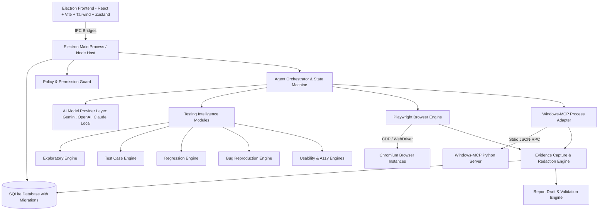
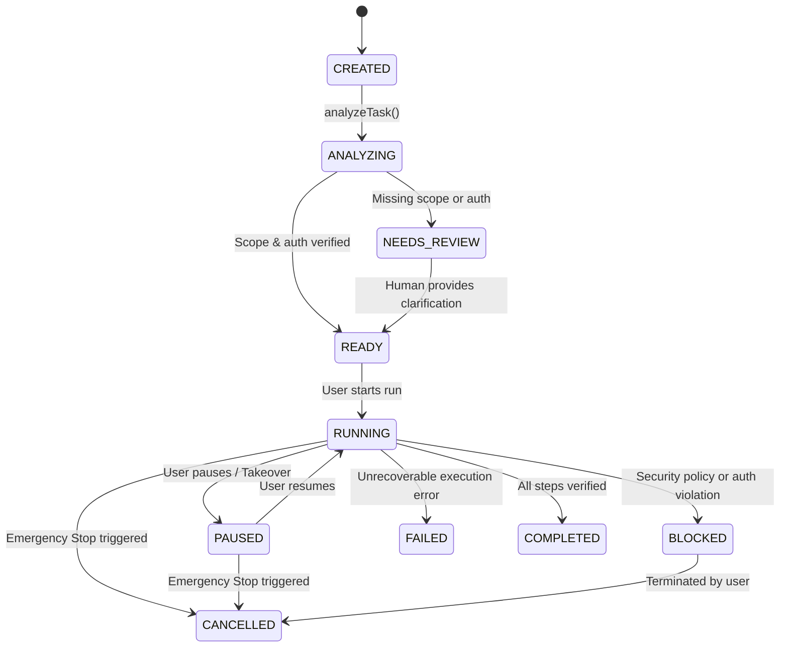

# Test IO Agent Studio — Architecture Specification
**Version:** 1.0 (Production-Oriented)  
**Status:** Approved for Implementation  
**Target Environment:** Windows 11 (with cross-platform abstraction for macOS/Linux)

---

## 1. High-Level Architecture Overview

Test IO Agent Studio is an autonomous and supervised AI-powered desktop & web testing application. It combines:
1. **Windows-MCP Integration**: Native desktop UI inspection and coordinate/label-based interaction via Model Context Protocol stdio transport.
2. **Playwright Browser Engine**: Deterministic, high-fidelity browser automation utilizing DOM locators, accessible roles, and network monitoring.
3. **AI Autonomous Agent Core**: State machine-governed observation-action-verification loop with structured planning and prompt-injection defense.
4. **Testing Intelligence Engines**: Exploratory, Test Case, Regression, Bug Reproduction, Usability, and Accessibility modules.
5. **Policy & Permission Guard**: Strict least-privilege enforcement preventing unauthorized domain navigation, shell execution, or unconsented platform submissions.
6. **Integrity-Verified Evidence & Report Engine**: SHA-256 hashed screenshots, console logs, network traces, and Test IO-compliant bug report drafts.



---

## 2. Monorepo Structure

```text
test-io-agent-studio/
├── apps/
│   ├── desktop/                 # Electron + React + Tailwind + Vite desktop app
│   └── demo-testing-lab/        # Standalone local test website with 10 intentional bugs
├── packages/
│   ├── shared/                  # Common TypeScript types, DTOs, schemas (Zod)
│   ├── storage/                 # SQLite schema, migrations, repositories
│   ├── policy-engine/           # PermissionGuard, domain policies, audit logger
│   ├── ai-providers/            # Multi-provider LLM abstraction (Gemini, Claude, OpenAI, Local)
│   ├── windows-mcp-adapter/     # Windows-MCP child process manager & client
│   ├── browser-adapter/         # Playwright session manager & web actions
│   ├── test-intelligence/       # QA engines: Exploratory, Test Case, Regression, etc.
│   ├── evidence/                # Evidence capture, SHA-256 verification & redaction
│   ├── report-engine/           # Bug report generator & validator
│   └── agent-core/              # Orchestrator, Task State Machine, Memory, Execution loop
├── tests/
│   ├── unit/                    # Unit tests for policy, planner, validators
│   ├── integration/             # Integration tests for MCP and Browser adapters
│   └── e2e/                     # End-to-end autonomous test run on Demo Lab
├── docs/                        # Complete architecture, security, and integration docs
└── config/                      # Policy, model provider, and runtime config files
```

---

## 3. Database Schema & Contract (SQLite)

The storage engine uses SQLite with write-ahead logging (WAL), foreign keys, and indexes:

1. **`tasks`**: Root testing tasks received or created by the user.
2. **`test_cycles`**: Test cycle definitions, platform metadata, and deadline tracking.
3. **`test_requirements`**: Granular requirements (in-scope, out-of-scope, device requirements).
4. **`test_plans`**: Plans generated by AI or loaded from specifications.
5. **`test_steps`**: Ordered steps within a test plan with goals and preconditions.
6. **`browser_sessions`**: Isolated browser instances, contexts, and tab references.
7. **`agent_runs`**: Execution runs tied to a task, mode (COPILOT, SUPERVISED, AUTHORIZED_AUTO), and state.
8. **`agent_actions`**: Granular actions proposed, approved, and executed.
9. **`observations`**: Captured web/desktop states (accessible nodes, URLs, forms).
10. **`verification_results`**: Assertion evaluations (PASS, FAIL, BLOCKED, NEEDS_REVIEW).
11. **`candidate_bugs`**: Potential bugs detected during verification with reproduction trails.
12. **`bug_verifications`**: Secondary reproduction results verifying candidate bugs.
13. **`evidence`**: Hashed artifacts (screenshots, traces, network logs) with redaction status.
14. **`report_drafts`**: Structured bug reports and test cycle summaries ready for human review.
15. **`authorizations`**: Cryptographically or administratively signed permission records.
16. **`audit_logs`**: Immutable security audit trails for every tool and action.
17. **`application_settings`**: User preferences, AI provider keys (stored safely), theme, timeouts.
18. **`model_usage`**: Token counting, cost tracking, and model latency metrics.

---

## 4. Task State Machine



---

## 5. Execution Modes & Human-in-the-Loop Guard

- **`COPILOT_MODE` (Default)**: AI analyzes requirements, generates test scenarios, and drafts reports. No automated physical or browser clicks are executed without manual step invocation.
- **`SUPERVISED_MODE`**: AI proposes each browser/desktop action with expected outcomes. The human operator clicks "Approve" before each action is dispatched.
- **`AUTHORIZED_AUTO_MODE`**: AI autonomously executes the observation-action-verification loop *only* against targets possessing a verified `AuthorizationRecord` in the database.
