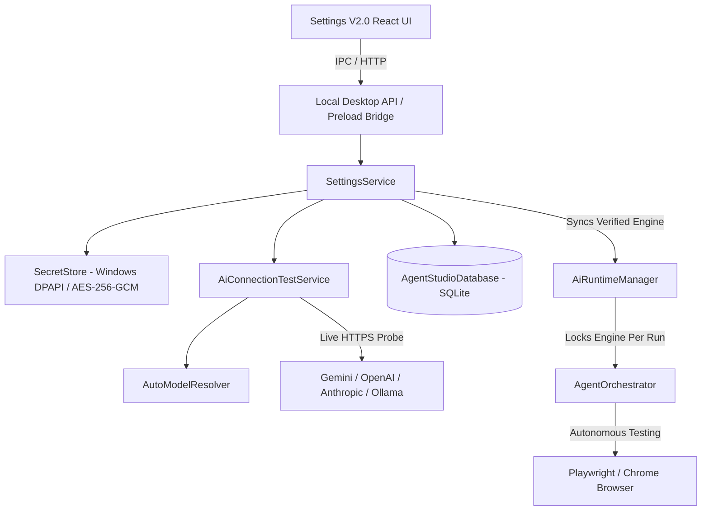

# Test IO Agent Studio — Settings V2.0 Implementation Guide

## 1. Executive Summary
Settings V2.0 transforms Test IO Agent Studio's static, non-operational provider dropdown into a secure, production-grade AI configuration center. Key improvements include:
- **Direct UI Credential Entry:** Users configure credentials (API keys, custom endpoints) directly in the Settings interface without manual editing of `.env` files.
- **Genuine Provider Connection Testing:** Real probes authenticate credentials and perform a minimal live inference probe (`Say READY`), measuring latency and classifying failures (e.g., `CONNECTED`, `INVALID_CREDENTIAL`, `MODEL_UNAVAILABLE`, `RATE_LIMITED`, `QUOTA_EXCEEDED`, `NETWORK_ERROR`). Mocks are eliminated from production flows.
- **Automated Model Discovery & Selection:** `AutoModelResolver` inspects provider catalogs dynamically, filtering out non-generative models and ranking stable, vision/reasoning-capable models (e.g., `gemini-3.5-flash`, `gpt-4o`, `claude-3-7-sonnet-20250219`, `llama3.2-vision:latest`). Technical model ID inputs are no longer required from users.
- **Operating-System Backed Secret Protection:** Plaintext keys are never stored in SQLite, `localStorage`, Zustand, or git-tracked files. Secrets are protected via Electron `safeStorage` (Windows DPAPI) with AES-256-GCM vault fallback and automated secret redaction in logs.
- **Run-Level Isolation & Orchestrator Integration:** `AgentOrchestrator` consumes the active verified AI engine via `AiRuntimeManager`. Once a test run begins, its provider and model are locked for the run lifecycle to prevent unexpected model switches mid-task.

---

## 2. Architecture & Component Diagram

---

## 3. Backend Services & Interfaces

### 3.1 `SettingsService`
- **Location:** `apps/desktop/src/main/services/settings_service.ts`
- **Responsibilities:**
  - Exposes `getPublicSettings()` returning non-sensitive metadata (`hasStoredCredential`, `connectionStatus`, `selectedModel`, `activeRuntime`, etc.). Never returns plaintext secrets.
  - `saveProviderKey(providerId, key)` stores credentials securely.
  - `testProviderConnection(providerId, draftKey?)` runs live connection tests and caches verification state.
  - `activateProvider(providerId, verifiedModel?)` sets the active provider for subsequent Agent runs.
  - `getActiveProviderConfiguration()` (backend-only) provides decrypted credentials and verified models to `AiRuntimeManager`.

### 3.2 `SecretStore`
- **Location:** `apps/desktop/src/main/services/secret_store.ts`
- **Responsibilities:**
  - Encrypts credentials via Electron `safeStorage` on Windows.
  - Automatic AES-256-GCM vault fallback keyed by machine/user salt for headless CLI and automated tests.
  - Provides atomic secret rotation, deletion, and centralized regex redaction (`SecretStore.redactSecret()`).

### 3.3 `AiConnectionTestService`
- **Location:** `packages/ai-providers/src/connection_test_service.ts`
- **Responsibilities:**
  - Executes live discovery and a minimal `READY` prompt probe across Google Gemini, OpenAI GPT, Anthropic Claude, and local Ollama servers.
  - Measures latency and maps HTTP/network errors to typed statuses (`INVALID_CREDENTIAL`, `MODEL_UNAVAILABLE`, `RATE_LIMITED`, `QUOTA_EXCEEDED`, `NETWORK_ERROR`, `SERVICE_UNAVAILABLE`).

### 3.4 `AutoModelResolver`
- **Location:** `packages/ai-providers/src/auto_model_resolver.ts`
- **Responsibilities:**
  - Queries provider `/models` endpoints dynamically.
  - Filters out audio/tts/embedding/whisper/moderation models.
  - Ranks candidates by stability, capabilities (vision, reasoning), and benchmark scores.

### 3.5 `AiRuntimeManager`
- **Location:** `packages/agent-core/src/ai_runtime_manager.ts`
- **Responsibilities:**
  - Interfaces between `SettingsService` and `AgentOrchestrator`.
  - Manages per-run provider locks (`getProviderForRun(runId)`, `getModelIdForRun(runId)`).
  - Supplies sanitized status for UI dashboards without exposing credentials.
